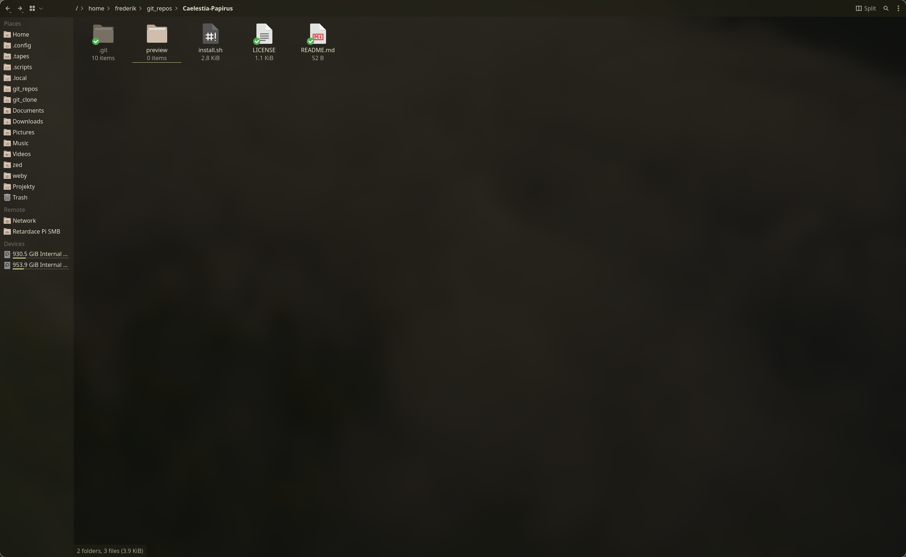
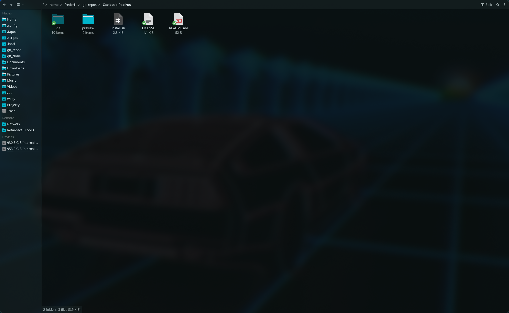

# Caelestia-Papirus  
Papirus Icon swither based on your wallpaper.  

<details>
<summary><h2>Screenshots</h2></summary>

  
  
  
</details>

# Instalation  
### You will need to do some sudoers shenanigans  
You will need to setup passwordless ```papirus-folders``` command, without this it wont work.  
If you dont want to do this, dont install this, it wont work.  
```  
echo "$USER ALL=(ALL) NOPASSWD: $(which papirus-folders)" | sudo tee /etc/sudoers.d/papirus-folders
sudo chmod 440 /etc/sudoers.d/papirus-folders   
```    
Then run install script and you its done.
```
git clone https://github.com/FrederikFazberovic/Caelestia-Papirus.git
cd Caelestia-Papirus
chmod +x install.sh
./install.sh
```

# Troubleshooting
If some custom icons (steam, music, etc.) stay unchanged, change them to ```folder-steam``` instead of ```folder-blue-steam```.  
That should fix it, if not, create an issue.
